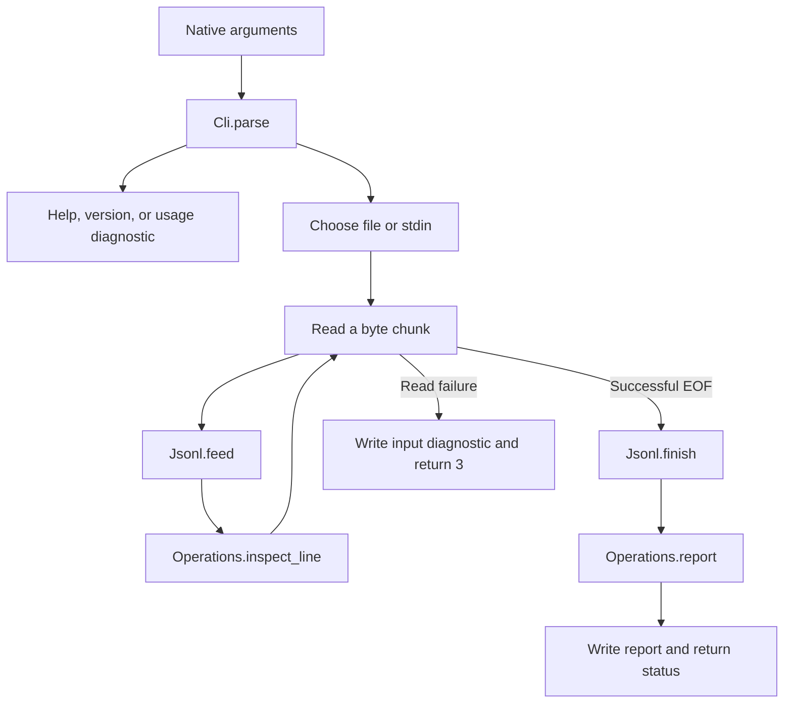

# Learning `main.roc`: connecting pure code to the operating system

Read alongside [the source](../../src/main.roc). This guide describes the current
M1 implementation using Roc `nightly-2026-10-09-258ab27` and `basic-cli` 0.25.0.
Commands run from the repository root. Newer Roc examples may use different APIs.

Start here for the program's overall flow, then read [Cli](Cli.roc.md),
[Jsonl](Jsonl.roc.md), and [Operations](Operations.roc.md) for the pure logic.

## The job of this file

`main.roc` owns the effects: accepting native arguments, opening a file, reading
bytes, writing output, and returning a process exit status. Other modules turn
values into new values without performing I/O.



This split makes framing and validation testable without constructing files or
operating-system descriptors. The executable tests still exercise real I/O.

## The application declaration and imports

The first line declares an application, exposes `main!` to its platform, and
binds the platform dependency to the local name `pf`:

```roc
app [main!] { pf: platform "https://github.com/roc-lang/basic-cli/releases/download/0.25.0/CZsY7tYZwR3rj9kYbpaCfxki2yVAaRL8bBwMLvB2xkbA.tar.zst" }
```

A platform supplies the operating-system integration that this application uses.
Here, `basic-cli` supplies argument/path types, standard streams, file readers,
and exit handling. The pinned URL keeps that interface reproducible.

`import Cli`, `import Jsonl`, and `import Operations` resolve the neighboring
project modules. `import pf.File` and similar imports resolve platform modules.
The `File` module name in `File.open_reader!` and the `File(native)` tag in a
source value have different roles; context distinguishes them.

| Import | Use in this application |
| --- | --- |
| `OsStr` | Preserve operating-system arguments, including native path data. |
| `Stdout`, `Stderr` | Write results and operational diagnostics. |
| `File`, `Path` | Open a native path as a buffered reader. |
| `IOErr` | Turn platform error categories into diagnostic text. |
| `Stdin` | Read raw chunks from standard input. |

## Reading a function signature

```roc
main! : List(OsStr) => Try({}, [Exit(I32)])
```

Read this as: “Given a list of native arguments, this effectful function returns
either an empty success value or an exit request carrying a signed 32-bit code.”

| Syntax | Meaning here |
| --- | --- |
| `name : Type` | An explicit type annotation. |
| `List(OsStr)` | A list whose elements are native argument values. |
| `=>` | An effectful function type; pure function types use `->`. |
| `!` in a function name | Marks an effectful function. |
| `Try(success, error)` | A result represented by `Ok(value)` or `Err(error)`. |
| `{}` | The empty record, used when success has no data to return. |
| `[Exit(I32)]` | A tag union with an `Exit` case carrying an `I32`. |
| `|args| expression` | A function implementation with one parameter. |

The brackets in `[Exit(I32)]` describe a type's alternatives. In a value such as
`[1, 2]`, brackets instead construct a list.

## `main!`: decide what to do before touching input

The implementation immediately matches on `Cli.parse(args)`. In this platform,
the argument list excludes the executable's own name.

`match` checks its branches in order. This pattern:

```roc
Ok({ operation: Help, .. })
```

requires a successful result whose record has `operation: Help`; `..` ignores
the other record fields. The branches implement these decisions:

| Parse result | Action |
| --- | --- |
| `Help` | Write the help string, which already includes its final newline. |
| `Version` | Write `jlog 0.1.0` with a newline. |
| `Err(Usage)` | Write a usage diagnostic to stderr and request exit 2. |
| `Inspect` with `File(native)` | Open the file and inspect it. |
| `Inspect` with `Stdin` | Inspect stdin with the label `<stdin>`. |
| Any other successful operation | Explain that it is unfinished and request exit 1. |

Count, tail, and filtering are recognized by the parser but have no processing
implementation yet. Help describes their intended behavior. Parsing an option
successfully does not imply that the application implements it.

Parsing first has observable benefits: `--help` finishes even if stdin stays
open, and invalid arguments produce a usage error before a missing file is opened.

### Error conversion and `?`

`report_failure!` converts a diagnostic write failure with this expression:

```roc
Stderr.line!(message).map_err(|_| Exit(3))?
```

`map_err` changes only the error case. `|_|` accepts an error value and ignores
its details, replacing it with `Exit(3)`. The trailing `?` unwraps `Ok` and
continues, or returns `Err` from the enclosing function immediately.

For a usage error, a successful diagnostic write is followed by `Err(Exit(2))`.
If writing fails, `?` returns `Err(Exit(3))` first. Output failure therefore
overrides the intended usage status. `!` identifies an effect; `?` propagates a
result error. They serve separate purposes.

## `write_stdout!` and `report_failure!`: shared output rules

`write_stdout!(text)` writes exactly the supplied text with `Stdout.write!` and
maps a write error to exit 3. Help and the completed report already contain their
newlines; the version branch explicitly supplies `"jlog 0.1.0\n"`. All result
writes use the same error policy without repeating the mapping at each call.

`report_failure!(message, code)` writes a diagnostic with `Stderr.line!`, then
returns `Err(Exit(code))`. That writer supplies the final LF. A write failure
returns exit 3 before the requested code can be returned. Usage errors, unfinished
operations, and input failures share this ordering through the helper.

The helpers express stream and status policy; they do not combine input reading
with rendering or hide whether a function performs I/O. Their `!` names and `=>`
signatures make that visible.

That policy depends on the platform returning an error. A manual macOS probe
with a read-only `/dev/null` descriptor as stdout still returned 0 for help; the
same kind of stderr descriptor still returned 2 for usage. Python confirmed the
descriptors reject writes, and the original and refactored binaries behaved
identically. This is an observed output-error detection gap, recorded in the
[progress log](../plans/jlog-v0.1-progress.md#readability-refactor--2026-10-26),
alongside the pending broader output-failure work. Mapping returned errors does
not establish detection of every unusable descriptor.

## `inspect_file!`: keep the path separate from its display label

The function takes an `OsStr`, obtains `native.display()` for the report label,
and opens `Path.from_os_str(native)` using the original native value.

This matters because a displayed path may be a lossy representation of native
data. Reconstructing an opening path from that text could refer to a different
file. Display conversion is for messages; native conversion is for opening.

On success, `File.open_reader!` returns a buffered reader. On failure, the pattern
`PathErr(err, _)` extracts the I/O error and ignores the accompanying path payload.
The explicit `return input_error!(...)` stops execution before entering the loop.

The successful reader is wrapped in `FromFile(reader)` so it can share the same
inspection loop as the payload-free `FromStdin` case.

## `inspect_reader!`: two pieces of state, one loop

The loop begins with:

```roc
var $current = { state: Jsonl.start, value: Operations.start }
var $reading = True
```

`var` introduces a local mutable variable, and `$` identifies its uses. Ordinary
bindings such as `bytes = ...` remain immutable within their scope. The mutation
here makes the effectful read loop direct to follow.

`$current` contains two independent states:

| Field | Contents |
| --- | --- |
| `state` | Framing state: unfinished bytes and the next physical line number. |
| `value` | Inspection state: totals and at most 100 invalid-line details. |

Each iteration calls `read_bytes!`. A read failure returns immediately through
`input_error!`; it does not finalize the framer or write a completed report.
An empty byte list means EOF after transport normalization. Otherwise:

```roc
$current = Jsonl.feed($current.state, bytes, $current.value, Operations.inspect_line)
```

passes the current summary and a function value to the framer. The function
`Operations.inspect_line` is called for each complete physical line. The framer
does not need to know what a summary contains.

At EOF, `Jsonl.finish` emits a pending unterminated line, if present. Its returned
`.value` is the final summary; `inspection_report!` writes it.

Incremental reading avoids storing the entire input. Memory still depends on the
largest physical line, transport buffers, temporary validation data, and capped
error details. There is no implemented maximum line length or measured whole-file
resource guarantee yet.

## `read_bytes!`: adapt the transports

```roc
read_bytes! : [FromFile(File.Reader), FromStdin] => Try(List(U8), [InputError(IOErr)])
```

The input union makes it explicit that a file source carries a reader and stdin
does not. Both branches return bytes, represented by unsigned 8-bit integers.

| Transport | Platform behavior | Shared-loop behavior |
| --- | --- | --- |
| File | `read_line!` includes the LF when present; empty bytes mean EOF. | Preserve bytes; map `FileErr(err)` to `InputError(err)`. |
| Stdin | `bytes!` reads chunks; EOF is an `EndOfFile` error case. | Map `EndOfFile` to `Ok([])`; preserve actual `StdinErr` failures. |

The loop can now treat either transport identically. It still sends file reads
through the framer because stdin chunks may split a line, CRLF, or UTF-8 sequence.

The pinned platform exposes a write-only stdin descriptor as EOF rather than a
read error. This adapter cannot distinguish that from genuine empty input.
Directory stdin does produce a propagated read failure. The
[handoff](../plans/jlog-handoff.md#known-limitations-and-risks) records the gap.

## `inspection_report!` and `input_error!`: output and status

`inspection_report!` first asks `Operations.report` to construct a string, then
passes it to `write_stdout!`. Writing successfully yields exit 4 if the summary has any
invalid records, or `Ok({})` otherwise. The platform maps that success to exit 0.
If the write fails, `?` returns exit 3 before the malformed-record check.

`input_error!` escapes the display label and delegates `jlog: LABEL: REASON` to
`report_failure!` with status 3. The shared helper writes to stderr and also
returns 3 if writing that diagnostic fails.

Malformed records are recoverable input data: they appear in the completed
inspection report on stdout. An open/read failure prevents completion and uses
stderr. A failed stdout write can leave partial output; the code cannot retract
bytes that were already written.

## Follow one input through the program

For the bytes represented by `{}\n\nnot-json\nnull`, the shared pipeline emits
four physical lines. Their classifications are valid, blank, invalid JSON, and
valid. EOF causes the final `null` to be emitted even without a trailing LF.

The report has `Records: 4`, `Valid: 2`, and `Invalid: 2`, with errors at physical
lines 2 and 3. Writing it succeeds, then the application returns exit 4.

## Try it and read the tests

```sh
roc run src/main.roc -- tests/sample.jsonl
printf '{}\n\nnot-json\nnull' | roc run src/main.roc
```

The sample reports six valid records and exit 0. The second command reports the
four-line example above and exit 4. The backslash escapes in `printf` produce
actual physical newlines.

The [Python executable suite](../../tests/test_cli.py) checks exact stdout,
stderr, and statuses, including held-open stdin, inaccessible files, long lines,
and file/stdin parity. See the [README](../../README.md#for-developers) for build
and test commands. Pure module checks alone cannot prove this I/O behavior.

As a reading exercise, trace `jlog missing.jsonl --unknown`: `Cli.parse` returns
`Usage`, so `inspect_file!` is never called. Then trace a valid input whose report
write fails: `inspection_report!` returns exit 3 before it can return success.
