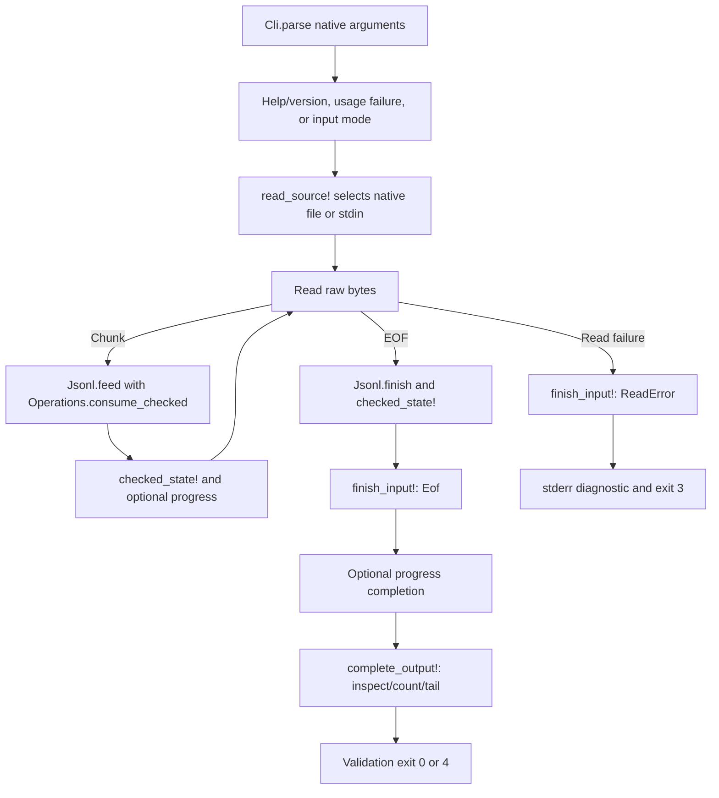

# Learning `main.roc`: effects, shared streaming, and completion

Read alongside [the source](../../src/main.roc). This guide describes the current
M1/M2 implementation using Roc `nightly-2026-10-09-258ab27` and `basic-cli` 0.25.0.
Commands run from the repository root. Newer examples may use different APIs.

Start here for overall flow, then read [Cli](Cli.roc.md), [Jsonl](Jsonl.roc.md),
and [Operations](Operations.roc.md) for the pure decisions and data transformations.

## The job of this file

`main.roc` owns native arguments/paths, file and stdin reads, clocks, stdout/stderr,
and process exits. It connects pure functions rather than duplicating JSON
validation or counter logic for each operation.



A resource check can stop earlier with exit 1. No completed count, tail, or
inspection report is emitted before successful EOF.

## The application declaration and imports

The `app [main!]` declaration exposes the entry point to the pinned platform and
binds that platform to `pf`. The long URL identifies the exact basic-cli bundle
used to build this executable. A platform supplies operating-system integration.

`import Cli`, `import Jsonl`, and `import Operations` resolve neighboring source
modules. Imports beginning with `pf.` resolve platform modules:

| Import | Purpose |
| --- | --- |
| `OsStr` | Native arguments and preserved path representation. |
| `File`, `Path` | Open a native file as a buffered reader. |
| `Stdin` | Read raw input chunks. |
| `Stdout`, `Stderr` | Separate result data from diagnostics/progress. |
| `IOErr` | Render an error category returned by the platform. |
| `Monotonic` | Measure elapsed nanoseconds for optional progress. |

The `File` module in `File.open_reader!` and the `File(native)` source tag have
different roles; context distinguishes them.

## Read the entry-point type

```roc
main! : List(OsStr) => Try({}, [Exit(I32)])
```

Read this as: given a list of native arguments, perform effects and return either
an empty success value or an explicit signed 32-bit exit request.

| Syntax | Meaning |
| --- | --- |
| `name : Type` | A type annotation. |
| `List(OsStr)` | A list of native argument values. |
| `=>` | An effectful function type; pure functions use `->`. |
| `!` in a name | Identifies an effectful function. |
| `Try(success, error)` | `Ok(value)` or `Err(error)`. |
| `{}` | Empty record: success has no additional payload. |
| `[Exit(I32)]` | A tag union containing an exit code. |
| `|args| expression` | A function implementation and its parameter. |

A bracketed type such as `[Exit(I32)]` describes alternatives; a bracketed value
such as `[1, 2]` is a list. In this platform, entry arguments exclude the
executable's own name.

## `main!`: select behavior before input effects

The dispatcher matches `Cli.parse(args)`. A record pattern such as
`Ok({ operation: Help, .. })` requires help while ignoring other fields.

| Request | Dispatch |
| --- | --- |
| Help | Write the embedded help string, including its existing newline. |
| Version | Write `jlog 0.1.0` and LF. |
| Usage failure | Report the usage diagnostic and request exit 2. |
| Inspect | Read the selected source with optional progress. |
| Count | Use the same reader with no inspection progress. |
| Tail(N) | Use the same reader with N-body retention and no inspection progress. |
| Filtering | Return the existing unfinished-operation status 1. |

`InputMode` contains only implemented input operations: `Inspect`, `Count`, and
`Tail(U32)`. It prevents the shared reader from accidentally receiving help or
an unfinished filter. Count and tail deliberately ignore the inspection-only
progress modifier; stderr remains available for their data diagnostics.

Parsing first means help finishes even if stdin stays open, and malformed flags
beat an inaccessible filename. Tests exercise both cases against the executable.

## Output writers and `report_failure!`

`write_stdout!` writes exact string bytes and maps a reported write failure to
`Exit(3)`. It adds no newline. `write_stderr!` does the same for diagnostic text,
including an entire capped diagnostic block. `write_stderr_line!` delegates to
that writer after concatenating one LF; progress and single-line errors share it.

The expression `.map_err(|_| Exit(3))` transforms only the error case. The `_`
parameter ignores the underlying write error because the CLI needs an I/O exit.
A caller such as `write_stderr_line!(message)?` unwraps success or returns the
error from its enclosing function immediately.

`report_failure!(message, failure)` writes a stderr line and returns the code
selected by `Operations.exit_code(Failed(failure))`. Its success type is generic:

```roc
report_failure! : Str, Operations.Failure => Try(a, [Exit(I32)])
```

This function always returns an error; it never constructs an `Ok(a)`. Its callers
can therefore use it in a function expecting either an empty success value or a
stream state. That avoids unreachable dummy success values in failure branches.
If writing the diagnostic itself fails, `?` returns exit 3 before the requested
usage/resource/internal code can be returned. It does not recursively report a
write failure through the same broken stream.

## `read_source!`: native paths and labels remain separate

A `Cli.Source` is either `File(native)` or `Stdin`. Stdin goes directly to the
reader with the display label `<stdin>`. A file branch obtains `native.display()`
for the label but opens `Path.from_os_str(native)` using the original native data.

A display string may be lossy, so rebuilding the opening path from it could
select a different file. The path used for opening is never reconstructed from
the report label.

`File.open_reader!` returns a reader or `PathErr(err, path)`. The error pattern
ignores the path payload and passes the label plus `IOErr.to_str(err)` to
`input_error!`. Opening happens before progress starts. A successful reader is
wrapped in `FromFile(reader)`; stdin uses `FromStdin`.

## `read_bytes!`: normalize EOF without swallowing read errors

The input union `[FromFile(File.Reader), FromStdin]` makes the file reader payload
explicit. Both cases produce `List(U8)`, raw unsigned-byte values.

| Transport | Platform result | Shared-loop result |
| --- | --- | --- |
| File | Buffered `read_line!` includes LF; empty bytes mean EOF. | Preserve bytes and map `FileErr` to `InputError`. |
| Stdin | `bytes!` reads at most 16,384 bytes; EOF is `EndOfFile`. | Convert EOF to `Ok([])` and preserve actual `StdinErr` failures. |

Both transports still pass through the same framer. A stdin chunk can split a
record, CRLF, or UTF-8 character; validation waits until the physical line exists.

## `process_reader!`: framing and checked operation state

The mode chooses a retention limit: tail uses its N; inspection/count use zero.
The loop begins with this shape:

```roc
var $current = { state: Jsonl.start, value: Ok(Operations.stream_start(limit)) }
var $progress = start_progress!(progress)
var $reading = True
```

`var` introduces a local mutable variable and `$` marks its references. Ordinary
bindings such as `bytes = ...` remain immutable within their scopes.

| Part | Contents |
| --- | --- |
| `$current.state` | Framing: pending bytes, physical line number, and exhaustion flag. |
| `$current.value` | `Try` containing shared counters/details and bounded tail, or a resource failure. |
| `$progress` | Quiet mode or the most recent displayed count and timestamp. |

A nonempty read is passed to `Jsonl.feed` with `Operations.consume_checked` as its
pure callback. Each line is classified once. The callback updates the shared
summary and retains a valid body only when tail storage is enabled. A fatal
counter error remains sticky in the accumulator.

After framing, `checked_state!` rejects either a framing-exhaustion flag or a
failed consumer. It reports a resource error and exit 1 before progress or
results can be written. Otherwise the summary is available for a progress check.
The loop does not retain earlier stream-state snapshots between iterations.

An empty read ends the loop. `Jsonl.finish` emits a final pending unterminated
record, if present, using the same checked callback. Its result is checked again,
then passed to `finish_input!` with `Eof`.

## `finish_input!`: one terminal decision before output

A reported read error also goes through `finish_input!`, but carries
`ReadError(reason)` and the last successful state. It does not call `Jsonl.finish`
on the incomplete prefix.

The helper calls the pure `Operations.complete_stream(state, event)`. For an
error it immediately returns through `input_error!`, dropping deferred output.
Only EOF success can call `finish_progress!` and `complete_output!`.

This is why malformed records before an I/O failure cannot cause a completed
count/tail/report or exit 4: the terminal read-error branch wins. Pure tests seed
prefixes with errors and retained bodies. Directory-stdin tests exercise actual
reported read errors; the advanced pseudo-terminal closure attempt was EOF, so
executable failure specifically after a consumed prefix remains unverified.

## Optional progress in the read loop

`ProgressOutput` is `Quiet` or `Reporting(Operations.Progress)`. `start_progress!`
reads `Monotonic.now!` only when explicitly enabled. Quiet runs perform no clock
reads or progress writes.

`update_progress!` reads the clock and asks `Operations.progress_due` whether at
least a second and new completed lines exist. If so, it writes a plain stderr
snapshot and stores the new count/timestamp only after the write succeeds.

`finish_progress!` prints a final `(complete)` snapshot after successful EOF,
including empty input and the final unterminated line. It is exempt from the
periodic interval. Failed reads/resources do not call that completion path.

There is no timer thread: updates are checked after reads, so blocked input and
very long records can delay them. The pinned API has no terminal detection;
newline-delimited text works for terminals and redirected stderr without cursor
controls, colors, or extra dependencies. A reported progress write failure is 3.

## `complete_output!`, `write_tail!`, and `validation_status`

`complete_output!` receives a completed stream state and selects rendering:

| Mode | stdout | stderr |
| --- | --- | --- |
| Inspect | `Operations.report`: header and malformed detail section. | Only requested progress or operational errors. |
| Count | `Operations.count_report`: valid count and LF. | Capped `Operations.data_diagnostics`. |
| Tail | Original retained bodies, each followed by LF. | Capped `Operations.data_diagnostics`. |

Data diagnostics are written before count/tail data. A reported stderr failure
stops completion rather than producing apparently successful data without its
diagnostics.

`write_tail!` iterates `Operations.tail_lines` with a `for` loop. It writes each
byte body through `Stdout.write_bytes!`, then adds LF. `?` inside the loop returns
from the whole function on a write failure. It does not serialize JSON or build
one large string containing all retained bytes. A failed write may leave partial
output; already-written bytes cannot be retracted.

After successful writes, `validation_status` calls the pure exit-code policy:
valid/empty input becomes `Ok({})`, mapped to process status 0 by the platform;
malformed input becomes `Err(Exit(4))`. N=0 tail still validates and can return 4
with empty stdout. Write failures return 3 before this validation status.

`input_error!` escapes a source label and delegates `jlog: LABEL: REASON` to
`report_failure!` with `IoFailure`. Neither diagnostics nor progress include
original record contents.

## Memory and known platform limits

Inspection/count retain the largest current line, buffers, validation temporaries,
and at most 100 malformed details. Tail additionally retains at most N valid
bodies, growing with received records rather than preallocating N slots. There
is no fixed total-input or individual-line cap. Large-file resource measurements
and native Linux execution remain release work.

The platform exposes write-only stdin as EOF and can suppress EBADF errors on
unusable stdout/stderr descriptors. These remain strict-contract gaps; mapping
returned errors cannot recover an error the interface does not expose. Actual
closed-pipe failures are tested to return 3, including help/version, data output,
and diagnostic/progress writes. See the [progress record](../plans/jlog-v0.1-progress.md)
for the observations and pending compatibility gate.

## Try it and read the tests

```sh
roc run src/main.roc -- tests/sample.jsonl
roc run src/main.roc -- --count tests/sample.jsonl
roc run src/main.roc -- --tail 2 tests/sample.jsonl
printf '{}\n\nnot-json\nnull' | roc run src/main.roc -- --count
```

The sample count is 6. The final command prints `2` and LF to stdout, details for
physical lines 2/3 to stderr, and exits 4. Tail's two sample records keep their
original bodies. The [Python suite](../../tests/test_cli.py) checks real streams,
EOF gating, native paths, permission failures, ring boundaries, and broken pipes.
See [README](../../README.md#for-developers) for complete build/test commands.

As an exercise, trace `missing.jsonl --unknown`: parsing fails before opening.
Then trace a count with a malformed prefix and a reported read failure: terminal
failure returns 3, while its deferred count and malformed details are discarded.
