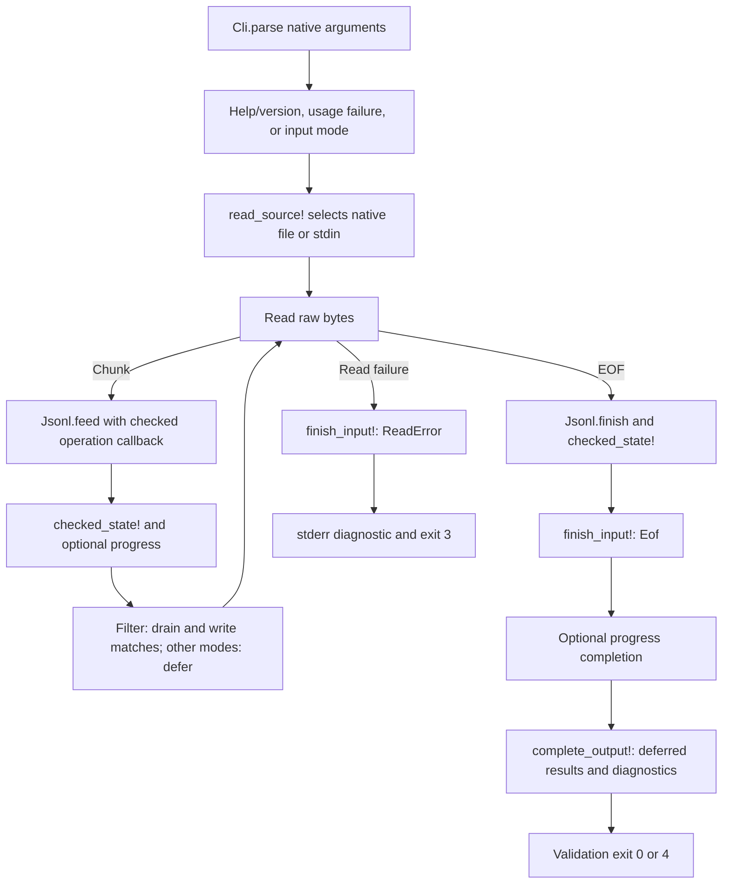

# Learning `main.roc`: effects, shared streaming, and completion

Read alongside [the source](../../src/main.roc). This guide describes the current
M1–M3 implementation using Roc `nightly-2026-10-09-258ab27` and `basic-cli` 0.25.0.
Commands run from the repository root. Newer examples may use different APIs.

Start here for overall flow, then read [Cli](Cli.roc.md), [Jsonl](Jsonl.roc.md),
and [Operations](Operations.roc.md) for the pure decisions and data transformations.

## The job of this file

`main.roc` owns native arguments/paths, file and stdin reads, clocks, stdout/stderr,
and process exits. It connects pure functions rather than duplicating JSON
validation or counter logic for each operation.



A resource check can stop earlier with exit 1. No completed count, tail, or
inspection report is emitted before successful EOF.

## The application declaration and imports

The `app [main!]` declaration exposes the entry point to the pinned platform and
binds that platform to `pf`. The long URL identifies the exact basic-cli bundle
used to build this executable. A platform supplies operating-system integration.

`import Cli`, `import Jsonl`, and `import Operations` resolve neighboring source
modules. Imports beginning with `pf.` resolve platform modules:

| Import | Purpose |
| --- | --- |
| `OsStr` | Native arguments and preserved path representation. |
| `File`, `Path` | Open a native file as a buffered reader. |
| `Stdin` | Read raw input chunks. |
| `Stdout`, `Stderr` | Separate result data from diagnostics/progress. |
| `IOErr` | Render an error category returned by the platform. |
| `Monotonic` | Measure elapsed nanoseconds for optional progress. |

The `File` module in `File.open_reader!` and the `File(native)` source tag have
different roles; context distinguishes them.

## Read the entry-point type

```roc
main! : List(OsStr) => Try({}, [Exit(I32)])
```

Read this as: given a list of native arguments, perform effects and return either
an empty success value or an explicit signed 32-bit exit request.

| Syntax | Meaning |
| --- | --- |
| `name : Type` | A type annotation. |
| `List(OsStr)` | A list of native argument values. |
| `=>` | An effectful function type; pure functions use `->`. |
| `!` in a name | Identifies an effectful function. |
| `Try(success, error)` | `Ok(value)` or `Err(error)`. |
| `{}` | Empty record: success has no additional payload. |
| `[Exit(I32)]` | A tag union containing an exit code. |
| `|args| expression` | A function implementation and its parameter. |

A bracketed type such as `[Exit(I32)]` describes alternatives; a bracketed value
such as `[1, 2]` is a list. In this platform, entry arguments exclude the
executable's own name.

## `main!`: select behavior before input effects

The dispatcher matches `Cli.parse(args)`. A record pattern such as
`Ok({ operation: Help, .. })` requires help while ignoring other fields.

| Request | Dispatch |
| --- | --- |
| Help | Write the embedded help string, including its existing newline. |
| Version | Write `jlog 0.1.0` and LF. |
| Usage failure | Report the usage diagnostic and request exit 2. |
| Inspect | Read the selected source with optional progress. |
| Count | Use the same reader with no inspection progress. |
| Tail(N) | Use the same reader with N-body retention and no inspection progress. |
| Where(filter) | Use the same reader, streaming matches without inspection progress. |

`InputMode` contains `Inspect`, `Count`, `Tail(U32)`, and
`Where({ key: Str, text: Str })`. It prevents the shared reader from receiving
information-only commands such as help and version. Data operations ignore the inspection-
only progress modifier; stderr remains available for their diagnostics.

Parsing first means help finishes even if stdin stays open, and malformed flags
beat an inaccessible filename. Tests exercise both cases against the executable.

## Output writers and `report_failure!`

`write_stdout!` writes exact string bytes and maps a reported write failure to
`Exit(3)`. It adds no newline. `write_stderr!` does the same for diagnostic text,
including an entire capped diagnostic block. `write_stderr_line!` delegates to
that writer after concatenating one LF; progress and single-line errors share it.

The expression `.map_err(|_| Exit(3))` transforms only the error case. The `_`
parameter ignores the underlying write error because the CLI needs an I/O exit.
A caller such as `write_stderr_line!(message)?` unwraps success or returns the
error from its enclosing function immediately.

`report_failure!(message, failure)` writes a stderr line and returns the code
selected by `Operations.exit_code(Failed(failure))`. Its success type is generic:

```roc
report_failure! : Str, Operations.Failure => Try(a, [Exit(I32)])
```

This function always returns an error; it never constructs an `Ok(a)`. Its callers
can therefore use it in a function expecting either an empty success value or a
stream state. That avoids unreachable dummy success values in failure branches.
If writing the diagnostic itself fails, `?` returns exit 3 before the requested
usage/resource/internal code can be returned. It does not recursively report a
write failure through the same broken stream.

## `read_source!`: native paths and labels remain separate

A `Cli.Source` is either `File(native)` or `Stdin`. Stdin goes directly to the
reader with the display label `<stdin>`. A file branch obtains `native.display()`
for the label but opens `Path.from_os_str(native)` using the original native data.

A display string may be lossy, so rebuilding the opening path from it could
select a different file. The path used for opening is never reconstructed from
the report label.

`File.open_reader!` returns a reader or `PathErr(err, path)`. The error pattern
ignores the path payload and passes the label plus `IOErr.to_str(err)` to
`input_error!`. Opening happens before progress starts. A successful reader is
wrapped in `FromFile(reader)`; stdin uses `FromStdin`.

## `read_bytes!`: normalize EOF without swallowing read errors

The input union `[FromFile(File.Reader), FromStdin]` makes the file reader payload
explicit. Both cases produce `List(U8)`, raw unsigned-byte values.

| Transport | Platform result | Shared-loop result |
| --- | --- | --- |
| File | Buffered `read_line!` includes LF; empty bytes mean EOF. | Preserve bytes and map `FileErr` to `InputError`. |
| Stdin | `bytes!` reads at most 16,384 bytes; EOF is `EndOfFile`. | Convert EOF to `Ok([])` and preserve actual `StdinErr` failures. |

Both transports still pass through the same framer. A stdin chunk can split a
record, CRLF, or UTF-8 character; validation waits until the physical line exists.

## `process_reader!`: framing and checked operation state

The mode chooses a retention limit: tail uses its N; other modes use zero.
The loop begins with this shape:

```roc
var $current = { state: Jsonl.start, value: Ok(Operations.stream_start(limit)) }
var $progress = start_progress!(progress)
var $reading = True
```

`var` introduces a local mutable variable and `$` marks its references. Ordinary
bindings such as `bytes = ...` remain immutable within their scopes.

| Part | Contents |
| --- | --- |
| `$current.state` | Framing: pending bytes, physical line number, and exhaustion flag. |
| `$current.value` | `StreamResult`: shared counters/details, bounded tail/current-read matches, or a resource/lookup failure. |
| `$progress` | Quiet mode or the most recent displayed count and timestamp. |

A local `consume` closure selects `Operations.filter_checked` for `Where(filter)`
and `Operations.consume_checked` otherwise. Capturing `mode` lets both `feed` and
`finish` use the same callback without duplicating their orchestration. Each
line is classified once; filtering additionally decodes valid objects to inspect
string fields. Both callbacks share counters, diagnostic caps, and sticky errors.

After framing, `checked_state!` rejects either a framing-exhaustion flag or a
failed consumer. Resource failures exit 1. `LookupFailure(number)` also exits 1
with an escaped source label and physical line number: validated JSON could not
be looked up as expected. It is never treated as malformed input or a nonmatch.
Otherwise the summary is available for a progress check.

For filtering, `Operations.drain_matches(checked)` then hands the current read's
matches to `write_records!`. Only the returned state with an empty match buffer
is stored in `$current` before the next read. This lets the pure callback select
records while the effectful loop writes them incrementally. A held-open stdin
test observes output before EOF. The loop retains no earlier state snapshots.

An empty read ends the loop. `Jsonl.finish` emits a final pending unterminated
record, if present, using the same checked callback. Its result is checked again,
then passed to `finish_input!` with `Eof`.

## `finish_input!`: one terminal decision before output

A reported read error also goes through `finish_input!`, but carries
`ReadError(reason)` and the last successful state. It does not call `Jsonl.finish`
on the incomplete prefix.

The helper calls the pure `Operations.complete_stream(state, event)`. For an
error it immediately returns through `input_error!`, dropping deferred output.
Only EOF success can call `finish_progress!` and `complete_output!`, which also
writes any match selected from the final unterminated line.

This is why malformed records before an I/O failure cannot cause a completed
count/tail/report or exit 4: the terminal read-error branch wins. Pure tests seed
prefixes with errors and retained bodies. Directory-stdin tests exercise actual
reported read errors. Filtering may already have emitted a prefix; failure drops
deferred state, leaves that prefix intact, and exits 3. Earlier pseudo-terminal
closures appeared as EOF. M4-01 establishes an actual prefix read failure with a
prefilled nonblocking pipe whose writer remains open: the next read reports
WouldBlock. Every input mode exits 3, the incomplete final body is discarded,
and only filtering retains its already-emitted complete record.

## Optional progress in the read loop

`ProgressOutput` is `Quiet` or `Reporting(Operations.Progress)`. `start_progress!`
reads `Monotonic.now!` only when explicitly enabled. Quiet runs perform no clock
reads or progress writes.

`update_progress!` reads the clock and asks `Operations.progress_due` whether at
least a second and new completed lines exist. If so, it writes a plain stderr
snapshot and stores the new count/timestamp only after the write succeeds.

`finish_progress!` prints a final `(complete)` snapshot after successful EOF,
including empty input and the final unterminated line. It is exempt from the
periodic interval. Failed reads/resources do not call that completion path.

There is no timer thread: updates are checked after reads, so blocked input and
very long records can delay them. The pinned API has no terminal detection;
newline-delimited text works for terminals and redirected stderr without cursor
controls, colors, or extra dependencies. A reported progress write failure is 3.

## `complete_output!`, `write_records!`, and `validation_status`

`complete_output!` receives a completed stream state and selects rendering:

| Mode | stdout | stderr |
| --- | --- | --- |
| Inspect | `Operations.report`: header and malformed detail section. | Only requested progress or operational errors. |
| Count | `Operations.count_report`: valid count and LF. | Capped `Operations.data_diagnostics`. |
| Tail | Original retained bodies, each followed by LF. | Capped `Operations.data_diagnostics`. |
| Where | Any final pending match, plus bodies already streamed per read. | Capped `Operations.data_diagnostics` at EOF. |

Data diagnostics are written before count/tail data. A reported stderr failure
stops completion rather than producing apparently successful data without its
diagnostics.

`write_records!` accepts a list of original byte bodies and iterates with a `for`
loop. Tail supplies `Operations.tail_lines`; filtering supplies drained matches
or the final EOF buffer. Each body goes through `Stdout.write_bytes!`, followed
by LF. `?` inside the loop returns from the whole function on a write failure.
It does not serialize JSON or build one large combined string. A failed write
may leave partial output; already-written bytes cannot be retracted.

Filtering writes its final pending match before EOF diagnostics, following the
same data-first behavior as its per-read matches. A broken stderr pipe can thus
yield exit 3 with a valid emitted prefix. The executable suite checks this
separately from count/tail's diagnostics-first deferred output.

After successful writes, `validation_status` calls the pure exit-code policy:
valid/empty input becomes `Ok({})`, mapped to process status 0 by the platform;
malformed input becomes `Err(Exit(4))`. N=0 tail still validates and can return 4
with empty stdout. Write failures return 3 before this validation status.

`input_error!` escapes a source label and delegates `jlog: LABEL: REASON` to
`report_failure!` with `IoFailure`. Neither diagnostics nor progress include
original record contents.

## Memory and known platform limits

Inspection/count retain the largest current line, buffers, validation temporaries,
and at most 100 malformed details. Tail additionally retains at most N valid
bodies, growing with received records rather than preallocating N slots.
Filtering additionally retains current-read matching bodies and temporary
top-level decoded fields. Stdin reads at most 16 KiB at a time, but a line spanning
reads can be arbitrarily large. File reads supply one buffered physical line.
Draining prevents match storage from growing with total output. There is no
fixed total-input or individual-line cap. M4-02's
[native macOS measurements](../measurements/m4-02-macos-arm64.md) now cover
roughly-1-KiB records up to 1,000,000 lines, a 4,000,000-record tail follow-up,
and a single 8 MiB body. Observed RSS follows line/retention size rather than
total input bytes in those samples. Supplemental
[Linux ARM64 Docker measurements](../measurements/m4-02-linux-arm64-docker.md)
also pass the resource matrix. The later
[native Linux x86-64 measurements](../measurements/m4-02-linux-x86_64-ci.md)
pass all 70 cases, and [native CI](../plans/m4-03-native-ci.md) executes both
required architectures while keeping the known descriptor failures visible.

The platform exposes write-only stdin as EOF and can suppress EBADF errors on
unusable stdout/stderr descriptors. These remain strict-contract gaps; mapping
returned errors cannot recover an error the interface does not expose. Actual
closed-pipe failures are tested to return 3, including help/version, data output,
and diagnostic/progress writes. See the [progress record](../plans/jlog-v0.1-progress.md)
for the observations and pending compatibility gate.

## Try it and read the tests

```sh
roc run src/main.roc -- tests/sample.jsonl
roc run src/main.roc -- --count tests/sample.jsonl
roc run src/main.roc -- --tail 2 tests/sample.jsonl
roc run src/main.roc -- --where status=failed tests/sample-big.jsonl
printf '{}\n\nnot-json\nnull' | roc run src/main.roc -- --count
```

The sample count is 6. The final command prints `2` and LF to stdout, details for
physical lines 2/3 to stderr, and exits 4. Tail's two sample records keep their
original bodies. The [Python suite](../../tests/test_cli.py) checks real streams,
EOF gating, streaming before EOF, literal string matching, native paths,
permission failures, ring boundaries, broken pipes, and real filter/count
pipelines. M3's representative test selects the original bodies at lines 2 and 3,
including nested data, escapes, duplicate keys, and huge numeric spellings.
See [README](../../README.md#for-developers) for complete build/test commands.

M4-01 adds exact specification-fixture checks across every mode/source, long
data records across stdin reads, safe diagnostic labels, redirects from malformed
sources, and normal SIGTERM behavior. The shared Python helper supplies source
variants and hand-written expected bytes; it does not reproduce Roc logic.
Large numeric parser oracles use exact integers and `Decimal`.
The nonblocking-pipe test also exercises a real read failure after a valid and
malformed prefix, without treating ordinary EOF as a fault.

The separate [strict descriptor suite](../../tests/test_io_contract.py) still
fails on the pinned platform: independent platform calls report EOF or success
for unusable descriptors. These failures are preserved as a release gate, with
no skipped assertions or changes to the exit-3 contract. See the
[audit](../plans/m4-01-audit.md) for current evidence and remaining work.

As an exercise, trace `missing.jsonl --unknown`: parsing fails before opening.
Then trace a count with a malformed prefix and a reported read failure: terminal
failure returns 3, while its deferred count and malformed details are discarded.
